# Dokumen Spesifikasi Teknis Program Komputer

# WargaDigi 21: Platform Digital Layanan dan Administrasi Warga RW

<!-- AI-INSTRUKSI: Dokumen ini disiapkan sebagai lampiran permohonan pencatatan Hak Cipta (jenis
ciptaan: Program Komputer). Saat diubah ke Word: "#" menjadi judul, "##" Heading 1, "###" Heading 2.
Tabel tetap tabel. Bagian bertanda [ISI] diisi oleh tim sebelum diajukan.

ATURAN DIAGRAM:
1. Setiap blok "> 🖼️ **DIAGRAM D-xx: <judul>**" adalah instruksi pembuatan gambar. Buat gambarnya
   sesuai isi blok, simpan dengan nama pada baris "Nama file", lalu GANTI blok instruksi tersebut
   (dan blok kode mermaid yang menyertainya, bila ada) dengan gambar. Jangan cetak teks instruksi.
2. Di bawah gambar tulis keterangan: "Gambar D-xx: <judul>" (rata tengah, miring, 10 pt).
3. Bila blok memiliki kode mermaid, kode itu adalah SUMBER isi diagram: semua elemen dan relasi di
   dalamnya wajib muncul. Boleh digambar ulang dengan alat lain (draw.io, PlantUML, Figma) agar lebih
   rapi, tetapi jangan menambah atau menghapus elemen.
4. Gaya seragam untuk semua diagram: latar putih; huruf sans-serif (Inter/Arial); warna utama hijau
   #198754 (sistem/aplikasi), biru #0D6EFD (aktor/pengguna), abu-abu #6C757D (layanan eksternal
   dan penyimpanan), merah #DC3545 (status ditolak/gagal), kuning #FFC107 (status menunggu).
   Garis 1,5 pt, panah tegas, label berbahasa Indonesia.
5. Ukuran: lebar 1600 px (rasio sesuai isi), format PNG, resolusi 300 dpi bila dicetak.
   Gambar diletakkan selebar margin halaman.
6. Daftar semua diagram ada di Lampiran "Daftar Diagram". -->

<!-- Format blok instruksi diagram:
> 🖼️ **DIAGRAM D-xx: <judul>**
> - **Jenis:** jenis diagram (UML use case, ERD, flowchart swimlane, dll.)
> - **Isi:** elemen yang wajib ada
> - **Tata letak:** arah dan pengelompokan
> - **Penekanan:** bagian yang diberi warna/garis tebal
> - **Sumber:** kode mermaid di bawah / tabel pada bagian X
> - **Nama file:** `D-xx-....png`
-->

| Data | Keterangan |
|---|---|
| Judul ciptaan | WargaDigi 21: Platform Digital Layanan dan Administrasi Warga RW |
| Jenis ciptaan | Program Komputer (aplikasi web dan Progressive Web App) |
| Versi dokumen | 1.0 |
| Versi program | Rilis 15 November 2026 (commit `eafadd4`, branch `main`) |
| Tanggal mulai dibuat | 25 Agustus 2026 (commit pertama repositori) |
| Tempat penerapan | RW 21 Desa Tanimulya, Kecamatan Ngamprah, Kabupaten Bandung Barat, Jawa Barat |
| Alamat penerapan | https://wargadigi21.com |
| Konteks | Program Pengabdian kepada Masyarakat (PkM) Politeknik Negeri Bandung |
| Tanggal pertama kali diumumkan | [ISI: tanggal aplikasi pertama kali dapat diakses publik] |
| Pemegang hak cipta | [ISI: misalnya Politeknik Negeri Bandung, sesuai ketentuan institusi] |

### Pencipta

| No | Nama |
|---|---|
| 1 | Lukmannul Hakim Firdaus, S.Kom., M.T. |
| 2 | Bambang Wisnuadhi, S.Si., M.T. |
| 3 | Asri Maspupah, S.ST., M.T. |
| 4 | Rahil Jumiyani, SST., M.Sc. |
| 5 | Santi Sundari, S.Si., M.T. |
| 6 | Zulkifli Arsyad, S.Kom., M.T. |
| 7 | Joe Lian Min, M.Eng. |

---

## Daftar Isi

1. Pendahuluan
2. Deskripsi Umum Ciptaan
3. Kebutuhan Fungsional
4. Kebutuhan Nonfungsional
5. Aktor dan Hak Akses
6. Desain Arsitektur
7. Desain Kelas dan Basis Data
8. Desain Alur Proses Utama
9. Desain Antarmuka
10. Keunikan dan Kebaruan Rancangan
11. Pengujian dan Penjaminan Mutu
12. Riwayat Pengembangan
13. Pernyataan Penggunaan Alat Bantu Kecerdasan Artifisial
14. Lampiran

---

## 1. Pendahuluan

### 1.1 Latar belakang

Administrasi di tingkat RT dan RW umumnya masih berjalan manual. Warga yang membutuhkan surat
pengantar harus mendatangi rumah Ketua RT lalu Ketua RW pada jam yang cocok. Data keluarga dicatat
di buku atau lembar kerja yang tersebar di tiap RT. Iuran dicatat tangan, sehingga warga sulit
melihat ke mana uang dipakai. Informasi kegiatan tersebar di grup percakapan dan mudah tenggelam.
Usaha kecil warga juga jarang punya etalase yang dikenal tetangga sendiri.

WargaDigi 21 dirancang untuk memindahkan proses tersebut ke satu aplikasi web yang bisa dibuka dari
HP, dengan alur kerja yang mengikuti struktur kepengurusan RT dan RW yang sebenarnya.

### 1.2 Tujuan

1. Mempercepat layanan surat pengantar warga dengan alur persetujuan berjenjang RT lalu RW dan
   tanda tangan digital, sehingga warga cukup mengunduh PDF surat yang sudah disahkan.
2. Menyediakan data kependudukan dan keluarga per RT yang terpusat, dengan perubahan data yang
   tercatat dan disetujui pengurus.
3. Meningkatkan transparansi keuangan RT, RW, dan DKM (pengurus masjid) melalui pencatatan iuran,
   transaksi, seto  ran, dan laporan yang dipublikasikan ke warga setelah disetujui.
4. Menjadi kanal informasi resmi (berita, agenda, pengumuman, dokumentasi kegiatan) dengan kendali
   persetujuan konten.
5. Menyediakan etalase usaha warga (Pojok UMKM) yang dikurasi pengurus RW.

### 1.3 Ruang lingkup

Program mencakup aplikasi web sisi server, antarmuka web responsif, Progressive Web App, layanan
notifikasi, integrasi OCR untuk membaca dokumen kependudukan, serta perangkat penerapan (Docker,
skrip setup dan pembaruan server). Data kependudukan resmi milik pemerintah (Dukcapil) tidak
terhubung langsung; data diisi dan diverifikasi oleh pengurus RT.

---

## 2. Deskripsi Umum Ciptaan

### 2.1 Gambaran singkat

WargaDigi 21 adalah aplikasi web multi-peran untuk satu lingkungan RW yang terdiri atas beberapa
RT. Setiap keluarga memiliki satu akun yang dipegang kepala keluarga atau anggota yang ditunjuk.
Pengurus (Ketua RT, Ketua RW, Admin RW, operator konten, operator keuangan, DKM, dan Admin Aplikasi)
masuk dengan akun masing-masing, dan satu orang dapat memegang beberapa peran sekaligus.

Analisis dan desain memakai pendekatan berorientasi objek (OOAD) dengan notasi UML: konsep bisnis
dimodelkan lebih dulu sebagai **model domain** (bagian 2.4), perilaku sistem sebagai **use case**
(bagian 5), lalu diturunkan menjadi **class diagram desain** (bagian 7.4), **diagram interaksi**
dan **diagram status/aktivitas** (bagian 8), serta **diagram komponen dan deployment** (bagian 6).
Implementasinya berupa kelas-kelas PHP (model Eloquent, service, adapter, trait) pada kerangka kerja
Laravel; ERD (bagian 7.2) adalah hasil pemetaan objek ke tabel relasional.

### 2.2 Ukuran ciptaan (per rilis 15 November 2026)

| Komponen | Jumlah |
|---|---|
| Model data (Eloquent) | 33 |
| Controller | 53 |
| Service (logika bisnis) | 29 |
| Migrasi basis data | 68 |
| Tabel basis data | 48 |
| Tampilan (Blade view) | 153 |
| Route (alamat halaman dan aksi) | 247 |
| File pengujian otomatis | 53 (463 kasus uji lulus) |
| Commit di repositori | 104 |

### 2.3 Teknologi

| Lapisan | Teknologi |
|---|---|
| Bahasa dan kerangka kerja | PHP 8.3, Laravel 13 |
| Antarmuka | Blade, Bootstrap 5, Bootstrap Icons, Chart.js, Vite |
| Basis data | MySQL 8 |
| Otorisasi | spatie/laravel-permission (RBAC) |
| Jejak audit | spatie/laravel-activitylog |
| Dokumen | barryvdh/laravel-dompdf (PDF surat dan laporan), maatwebsite/excel (ekspor) |
| Notifikasi browser | minishlink/web-push (Web Push, VAPID), service worker |
| OCR | OCR.space HTTP API melalui adapter yang dapat diganti |
| Pengolahan gambar | GD (konversi WebP) |
| Penerapan | Docker (Nginx, PHP-FPM, queue worker, scheduler dalam Supervisor), Caddy (HTTPS) |

### 2.4 Model domain

Model domain menggambarkan konsep nyata di lingkungan RW dan hubungannya, sebelum memikirkan tabel
atau kode. Satu RW terdiri atas beberapa RT; satu RT memiliki banyak Keluarga; satu Keluarga
beranggota banyak Penduduk dan diwakili satu Akun Keluarga yang dipegang salah satu anggotanya.
Pengurus adalah Penduduk yang memegang Jabatan pada masa tertentu. Setiap unit pengelola keuangan
(RT, RW, DKM) memiliki Kas sendiri.

| Konsep | Arti dalam domain |
|---|---|
| RW, RT | Wilayah dan unit kepengurusan; RT bagian dari RW |
| Keluarga | Satu Kartu Keluarga di satu RT |
| Penduduk | Anggota keluarga dengan NIK |
| Akun | Identitas masuk; dapat memegang beberapa Peran sekaligus |
| Peran | Warga, Ketua RT, Ketua RW, Admin RW, operator, DKM, Admin Aplikasi |
| Jabatan Pengurus | Penduduk yang menjabat (Ketua, Sekretaris, Bendahara) pada RT/RW dalam masa tertentu |
| Pengajuan Perubahan Data | Permintaan warga mengubah data keluarga atau pemegang akun |
| Pengajuan Surat | Permintaan surat keterangan untuk seorang Penduduk; menghasilkan Dokumen Surat |
| Unit Keuangan | RT, RW, atau DKM sebagai pemilik kas |
| Rekening, Kategori, Transaksi | Pembukuan kas suatu unit |
| Iuran Bulanan, Tagihan Insidental, Pembayaran | Kewajiban keluarga dan pelunasannya |
| Setoran | Pemindahan bagian iuran dari RT ke RW |
| Laporan Keuangan | Ringkasan kas bulanan suatu unit, disetujui lalu dipublikasikan |
| Konten (Berita, Agenda, Pengumuman) | Informasi dari pengurus RT/RW, berkategori |
| Kehadiran, Dokumentasi | Konfirmasi hadir warga dan foto kegiatan agenda |
| Usaha, Produk | Usaha warga dan barang/jasanya di Pojok UMKM |

> 🖼️ **DIAGRAM D-01: Model Domain WargaDigi 21 (Class Diagram Konseptual)**
> - **Jenis:** UML class diagram tingkat konseptual (domain model). Hanya nama kelas konseptual,
>   atribut esensial tanpa tipe data, dan asosiasi bernama dengan multiplisitas. **Tanpa operasi,
>   tanpa kunci asing, tanpa nama tabel.**
> - **Isi:** semua kelas, atribut, generalisasi, dan asosiasi pada kode mermaid di bawah
> - **Tata letak:** empat kelompok (paket) berwarna latar lembut: Kependudukan dan Kepengurusan
>   (kiri atas), Layanan Surat (kiri bawah), Keuangan (kanan atas), Informasi dan UMKM (kanan
>   bawah); RT dan Keluarga di tengah sebagai pusat
> - **Penekanan:** generalisasi Konten → Berita/Agenda/Pengumuman dan UnitKeuangan → RT/RW/DKM
>   digambar dengan segitiga terbuka; nama asosiasi ditulis miring di tengah garis
> - **Sumber:** kode mermaid di bawah dan tabel konsep di atas
> - **Nama file:** `D-01-model-domain.png`

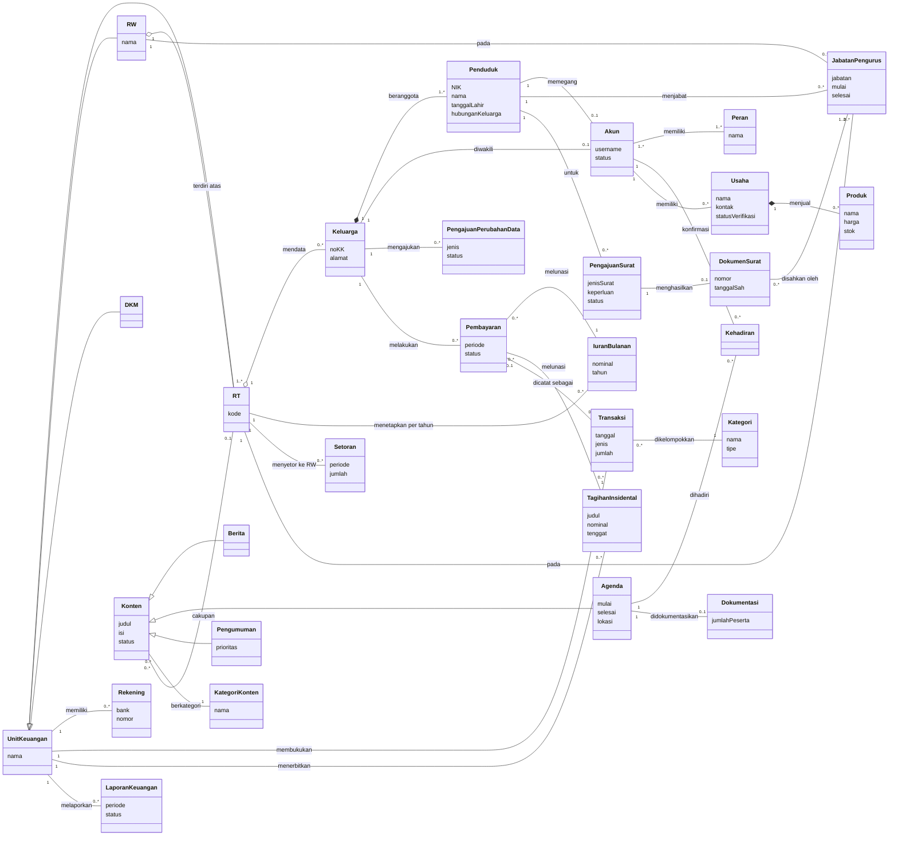

---

## 3. Kebutuhan Fungsional

Kode kebutuhan: `FR-<modul>-<nomor>`.

### 3.1 Autentikasi dan peran (AUTH)

| Kode | Kebutuhan |
|---|---|
| FR-AUTH-01 | Pengguna masuk dengan username atau nomor WhatsApp keluarga dan kata sandi. |
| FR-AUTH-02 | Satu akun dapat memiliki lebih dari satu peran; pengguna memilih peran aktif setelah masuk dan dapat berganti peran tanpa keluar. |
| FR-AUTH-03 | Akun keluarga baru diaktifkan melalui tautan aktivasi bertoken yang dibagikan Ketua RT. |
| FR-AUTH-04 | Akun berstatus Nonaktif atau belum diaktivasi ditolak saat masuk dengan pesan yang berbeda. |
| FR-AUTH-05 | Menu dan hak akses halaman ditentukan oleh peran aktif. |

### 3.2 Kependudukan dan keluarga (PDD)

| Kode | Kebutuhan |
|---|---|
| FR-PDD-01 | Ketua RT mendata keluarga baru beserta anggotanya, termasuk unggah foto KK dan KTP. |
| FR-PDD-02 | Data KK dan KTP dapat dibaca otomatis (OCR) untuk mengisi formulir, dengan pengisian manual sebagai cadangan. |
| FR-PDD-03 | Warga mengajukan tambah anggota, perubahan data KK, perubahan data anggota, dan pindah pemegang akun; setiap pengajuan disetujui Ketua RT lalu Admin RW. |
| FR-PDD-04 | Pemindahan pemegang akun mencabut peran Warga dari pemegang lama tanpa menghapus peran pengurusnya. |
| FR-PDD-05 | Pengurus RT dan RW melihat, mencari, memfilter, dan mengekspor data penduduk sesuai wilayahnya. |
| FR-PDD-07 | Kode wilayah (provinsi, kabupaten, kecamatan, kelurahan) diturunkan dari NIK dan dicocokkan dengan data wilayah. |

### 3.3 Layanan surat (SRT)

| Kode | Kebutuhan |
|---|---|
| FR-SRT-01 | Warga mengajukan 9 jenis surat: Kartu Keluarga, Kartu Tanda Penduduk, Keterangan Ahli Waris, Kelahiran, Kematian, Keterangan Domisili, Keterangan Tidak Mampu, Keterangan Serbaguna, Kelakuan Baik/Catatan Kepolisian. |
| FR-SRT-02 | Pengajuan dapat dibuat atas nama anggota keluarga mana pun; data diri terisi otomatis dari data penduduk. |
| FR-SRT-03 | Setiap jenis surat memiliki isian tambahan sendiri (misalnya lama tinggal, data pewaris, data bayi). |
| FR-SRT-04 | Ketua RT menyetujui dengan tanda tangan dan stempel digital atau menolak dengan alasan. |
| FR-SRT-05 | Pengurus RW mengesahkan atau menolak surat yang telah disetujui RT. |
| FR-SRT-06 | Surat yang selesai menghasilkan PDF berkop dengan nomor surat, tanda tangan, dan stempel, yang dapat diunduh warga. |
| FR-SRT-07 | Data surat disimpan sebagai snapshot saat pengesahan, sehingga PDF tetap sama walaupun data penduduk berubah setelahnya. |
| FR-SRT-08 | Ketua RT dan Ketua RW menyimpan tanda tangan dan stempel bawaan. |

### 3.4 Keuangan (KEU)

| Kode | Kebutuhan |
|---|---|
| FR-KEU-01 | Keuangan dikelola terpisah untuk tiga unit: RT, RW, dan DKM, masing-masing dengan rekening, kategori, transaksi, dan laporan sendiri. |
| FR-KEU-02 | Master Iuran bulanan per RT dengan riwayat perubahan nominal. |
| FR-KEU-03 | Tagihan insidental (Iuran Lainnya) per unit; tagihan RW dapat dikumpulkan lewat RT. |
| FR-KEU-04 | Warga membayar dengan mengunggah bukti; bendahara memverifikasi atau menolak. |
| FR-KEU-05 | RT menyetor bagian RW berdasarkan nominal per KK yang diatur RW; RW mengonfirmasi setoran. |
| FR-KEU-06 | Transaksi pemasukan dan pengeluaran dengan kategori dan bukti foto, termasuk pengambilan foto langsung dari kamera. |
| FR-KEU-07 | Laporan bulanan disusun bendahara, diajukan ke penyetuju (laporan RT ke Ketua RT; laporan RW dan DKM ke pengurus RW), lalu dipublikasikan ke warga oleh bendahara; tersedia unduhan PDF dan Excel. |
| FR-KEU-08 | Kategori transaksi dikelola berjenjang: kategori umum (Admin Aplikasi), kategori unit, dan kategori khusus DKM. |
| FR-KEU-09 | Dashboard statistik keuangan untuk pimpinan. |

### 3.5 Informasi dan komunikasi (INF)

| Kode | Kebutuhan |
|---|---|
| FR-INF-01 | Operator konten RW dan RT membuat berita, agenda, dan pengumuman dengan kategori dari master. |
| FR-INF-02 | Persetujuan konten dapat diaktifkan atau dinonaktifkan per jenis konten oleh Admin Aplikasi; konten yang perlu persetujuan diperiksa Admin RW. |
| FR-INF-03 | Status konten: Draft, Review, Revisi, Publish, Archive, dengan catatan revisi. |
| FR-INF-04 | Konten tingkat RT hanya ditujukan kepada warga RT tersebut; berita RT juga tampil di halaman publik dengan penanda asal. |
| FR-INF-05 | Agenda dengan konfirmasi kehadiran (RSVP) dan galeri dokumentasi setelah acara. |
| FR-INF-06 | Halaman publik: beranda, berita, agenda dan kalender kegiatan, dengan alamat (slug) yang mudah dibaca. |
| FR-INF-07 | Isi HTML dari editor disaring sebelum ditampilkan. |

### 3.6 UMKM (UMK)

| Kode | Kebutuhan |
|---|---|
| FR-UMK-01 | Warga mendaftarkan satu atau beberapa usaha, dengan kontak dan alamat yang dapat diambil dari profil keluarga. |
| FR-UMK-02 | Admin RW menyetujui atau menolak pendaftaran dengan catatan; usaha yang ditolak dapat diperbaiki dan diajukan ulang. |
| FR-UMK-03 | Admin RW dapat menonaktifkan dan mengaktifkan kembali usaha. |
| FR-UMK-04 | Pemilik mengelola produk, kategori produk, harga, dan status stok. |
| FR-UMK-05 | Pojok UMKM publik menampilkan usaha dan produk yang disetujui, dengan tautan WhatsApp dan pencatatan jumlah klik. |

### 3.7 Pengelolaan sistem (SYS)

| Kode | Kebutuhan |
|---|---|
| FR-SYS-01 | Pengaturan identitas instansi, logo, logo kop surat, gambar halaman masuk, dan ikon aplikasi. |
| FR-SYS-02 | Pengaturan Halaman Utama tanpa mengubah kode: teks banner, tiga gambar banner (bawaan, galeri, atau unggah), footer, dan daftar mitra beserta logo. |
| FR-SYS-03 | Manajemen kepengurusan (Ketua RW, Ketua RT, sekretaris, bendahara) beserta riwayat masa jabatan; nama pejabat aktif dipakai pada surat dan laporan. |
| FR-SYS-04 | Manajemen hak akses pengguna dan peran. |
| FR-SYS-05 | Log aktivitas seluruh perubahan penting. |
| FR-SYS-06 | Notifikasi di aplikasi untuk setiap perubahan status, dan notifikasi browser (Web Push) bila dikonfigurasi. |

---

## 4. Kebutuhan Nonfungsional

| Kode | Aspek | Kebutuhan dan cara pemenuhan |
|---|---|---|
| NFR-01 | Keamanan akses | Otorisasi berbasis peran pada setiap route; pembatasan data per RT pada data penduduk, pengajuan perubahan data, konten, dan keuangan; aksi persetujuan UMKM dan konten tidak dapat dipanggil langsung oleh peran yang tidak berhak (HTTP 403). |
| NFR-02 | Privasi dokumen | Tanda tangan dan stempel bawaan pengurus disimpan di penyimpanan privat dan hanya dibuka lewat route berotorisasi; berkas unggahan sementara terikat ke akun pengunggahnya dan dibersihkan terjadwal; nama berkas unggahan dibuat acak. Foto KTP/KK dan bukti pembayaran saat ini disimpan di penyimpanan publik aplikasi; pemindahan ke penyimpanan privat tercatat sebagai pengembangan lanjutan. |
| NFR-03 | Keamanan konten | Penyaringan HTML (sanitizer) pada konten editor; proteksi CSRF; validasi input di sisi server. |
| NFR-04 | Jejak audit | Perubahan data penting dicatat di log aktivitas. |
| NFR-05 | Ramah HP | Antarmuka responsif, dapat dipasang sebagai PWA, kamera perangkat dapat dipakai untuk foto dokumen. |
| NFR-06 | Efisiensi penyimpanan | Foto unggahan dikonversi ke WebP saat disimpan (uji awal: penghematan sekitar 85%); berkas sementara dibersihkan terjadwal. |
| NFR-07 | Ketahanan | OCR dan Web Push bersifat opsional: bila layanan tidak tersedia, aplikasi tetap berjalan dengan isian manual dan notifikasi di aplikasi. |
| NFR-08 | Kemudahan penerapan | Paket Docker, skrip setup sekali jalan, dan skrip pembaruan dengan backup serta rollback otomatis. |
| NFR-09 | Keterpeliharaan | Struktur modular (Controller, Service, Model, Policy), adapter untuk layanan eksternal, 463 kasus uji otomatis. |

---

## 5. Aktor dan Hak Akses

### 5.1 Daftar peran

| Peran | Tanggung jawab utama |
|---|---|
| Warga (pemegang akun keluarga) | Profil keluarga, pengajuan surat, pembayaran iuran, RSVP agenda, usaha UMKM |
| Ketua RT | Pendataan keluarga, persetujuan surat dan perubahan data tahap RT, persetujuan laporan keuangan RT |
| Op Konten RT | Konten tingkat RT |
| Op Keuangan RT | Iuran, tagihan, transaksi, setoran ke RW, laporan RT |
| Admin RW | Pengesahan surat, persetujuan perubahan data tahap RW, persetujuan konten, persetujuan dan pengelolaan UMKM, data RT |
| Ketua RW | Pengesahan surat, pemantauan dan statistik |
| Op Konten RW | Konten tingkat RW, galeri, master kategori konten |
| Op Keuangan RW | Keuangan RW, tagihan RW, penerimaan setoran RT |
| DKM | Keuangan masjid (dana kematian, pengadaan) |
| Admin Aplikasi | Pengaturan sistem, Halaman Utama, kepengurusan, hak akses, kategori transaksi umum, log |

> 🖼️ **DIAGRAM D-02: Diagram Use Case WargaDigi 21**
> - **Jenis:** UML use case diagram
> - **Isi:** batas sistem "WargaDigi 21"; aktor dan use case berikut:
>   - Pengunjung Publik: Melihat Beranda, Membaca Berita, Melihat Agenda, Melihat Pojok UMKM
>   - Warga: Masuk dan Pilih Peran, Mengelola Profil Keluarga, Mengajukan Perubahan Data, Mengajukan
>     Surat, Mengunduh PDF Surat, Membayar Iuran/Tagihan, Melihat Laporan Keuangan, Konfirmasi
>     Kehadiran Agenda, Mendaftarkan Usaha, Mengelola Produk
>   - Ketua RT: Mendata Keluarga Baru (include: Membaca KK/KTP dengan OCR), Menyetujui Surat
>     (include: Menandatangani Digital), Menyetujui Perubahan Data, Menyetujui Laporan RT
>   - Op Konten RT / Op Konten RW: Mengelola Berita, Mengelola Agenda, Mengelola Pengumuman,
>     Mengunggah Galeri; Op Konten RW juga Mengelola Kategori Konten
>   - Op Keuangan RT / Op Keuangan RW / DKM: Mencatat Transaksi, Mengelola Iuran dan Tagihan,
>     Memverifikasi Pembayaran, Menyusun Laporan; Op Keuangan RT juga Menyetor ke RW; Op Keuangan RW
>     juga Mengonfirmasi Setoran RT
>   - Admin RW: Mengesahkan Surat, Menyetujui Perubahan Data, Menyetujui Konten, Menyetujui UMKM,
>     Menonaktifkan Usaha
>   - Ketua RW: Mengesahkan Surat, Melihat Statistik
>   - Admin Aplikasi: Mengatur Sistem, Mengatur Halaman Utama, Mengelola Kepengurusan, Mengelola
>     Hak Akses, Melihat Log Aktivitas
> - **Tata letak:** aktor masyarakat (Publik, Warga) di kiri; pengurus RT di kiri bawah; pengurus RW,
>   DKM, dan Admin Aplikasi di kanan; use case dikelompokkan dalam paket: Kependudukan, Surat,
>   Keuangan, Informasi, UMKM, Sistem
> - **Penekanan:** relasi generalisasi "Warga" sebagai aktor dasar untuk Ketua RT yang juga warga
>   (catatan: satu akun dapat memiliki beberapa peran)
> - **Sumber:** tabel 5.1, 5.2, dan bagian 3; nama use case konsisten dengan model domain D-01
> - **Nama file:** `D-02-use-case.png`

### 5.2 Matriks hak akses ringkas

Keterangan: **K** = kelola/proses, **S** = setujui, **L** = lihat, **-** = tidak ada akses.

| Fitur | Warga | Ketua RT | Op Konten RT | Op Keu RT | Admin RW | Ketua RW | Op Konten RW | Op Keu RW | DKM | Admin App |
|---|---|---|---|---|---|---|---|---|---|---|
| Profil keluarga | K | L | - | - | L | L | - | - | - | - |
| Pendataan keluarga | - | K | - | - | L | L | - | - | - | - |
| Perubahan data keluarga | K (ajukan) | S | - | - | S | S | - | - | - | - |
| Surat | K (ajukan) | S | - | - | S | S | - | - | - | - |
| Konten RT | L | L | K | - | S | L | - | - | - | - |
| Konten RW | L | L | - | - | S | L | K | - | - | - |
| Iuran dan tagihan | K (bayar) | - | - | K | L | L | - | K | K | - |
| Laporan keuangan | L | S (RT) | - | K | S | S | - | K | K | - |
| UMKM | K (usaha sendiri) | L | L | - | S, K | L | L | - | - | L |
| Pengaturan sistem | - | - | - | - | - | - | - | - | - | K |

Catatan: persetujuan laporan keuangan RW dan DKM oleh Admin RW atau Ketua RW dibuka melalui tautan
notifikasi pengajuan; menu samping untuk halaman tersebut sedang disembunyikan pada rilis ini.

---

## 6. Desain Arsitektur

### 6.1 Gaya arsitektur

Aplikasi berbentuk monolit modular berbasis Laravel. Logika dibagi menjadi lapisan:

- **Route dan middleware**: memetakan alamat ke controller dan memeriksa peran.
- **Controller**: menerima permintaan, memvalidasi, dan memanggil service.
- **Service**: logika bisnis yang dipakai lintas modul, misalnya alur konten (`KontenWorkflow`),
  pengesahan tanda tangan (`TandaTanganPengesahan`), pembentukan data surat (`SuratDataBuilder`),
  konversi gambar (`KonversiGambarWebp`), Halaman Utama (`HalamanUtama`), notifikasi
  (`NotificationService`), dan OCR (`OcrService` dengan parser KK dan KTP).
- **Model**: entitas data beserta relasinya.
- **Adapter layanan eksternal**: kontrak `OcrProvider` dengan implementasi OCR.space dan Null,
  serta kanal Web Push.

> 🖼️ **DIAGRAM D-03: Arsitektur Penerapan (Deployment)**
> - **Jenis:** UML deployment diagram (node, artefak, dan jalur komunikasi)
> - **Isi:** perangkat pengguna (browser dan PWA di HP/laptop); server Linux berisi Caddy (HTTPS),
>   container aplikasi (Nginx, PHP-FPM Laravel 13, Queue worker, Scheduler, dikelola Supervisor),
>   container MySQL 8, volume penyimpanan berkas; layanan eksternal OCR.space dan Web Push
> - **Tata letak:** kiri ke kanan: pengguna → Internet → server (kotak besar) → layanan eksternal di
>   kanan; di dalam server, container aplikasi dan container basis data digambar sebagai node
>   terpisah dengan ikon Docker
> - **Penekanan:** jalur HTTPS (garis tebal hijau); layanan eksternal garis putus-putus "opsional"
> - **Sumber:** kode mermaid di bawah dan bagian 6.3
> - **Nama file:** `D-03-arsitektur-penerapan.png`

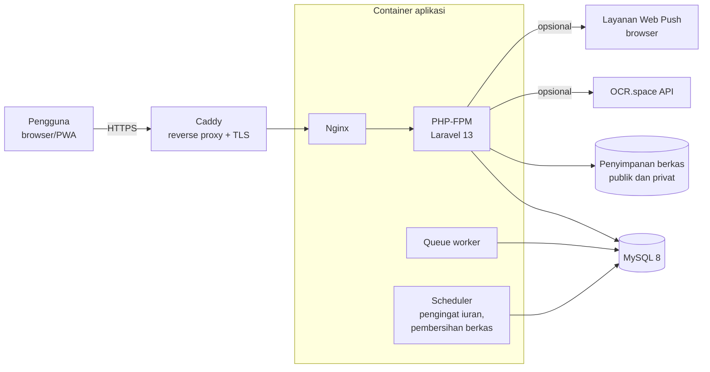

### 6.2 Komponen lintas modul

| Komponen | Fungsi |
|---|---|
| `KontenWorkflow` | Menentukan status konten saat disimpan, diajukan, disetujui, dikembalikan, dan diarsipkan, mengikuti pengaturan persetujuan per jenis konten |
| `SuratDataBuilder` | Menyusun data surat dari penduduk, keluarga, pejabat aktif, dan isian tambahan, lalu menyimpan snapshot |
| `TandaTanganPengesahan` | Menempelkan tanda tangan dan stempel pada pengesahan RT dan RW |
| `OcrService` + `KkParser` + `KtpParser` | Mengirim gambar ke penyedia OCR, lalu mengurai teks menjadi kolom KK dan KTP |
| `KonversiGambarWebp` | Mengubah foto unggahan menjadi WebP dengan batas ukuran dan kualitas |
| `DokumenSementara` | Menyimpan berkas sementara milik pengunggah sampai formulir disimpan |
| `HalamanUtama` | Membaca dan menyimpan konfigurasi banner, footer, dan mitra |
| `HtmlAman` | Menyaring HTML konten |
| `NotificationService` | Mengirim notifikasi database dan Web Push sesuai pengaturan |

> 🖼️ **DIAGRAM D-04: Arsitektur Lapisan dan Komponen Aplikasi**
> - **Jenis:** UML component diagram berlapis (layered architecture), komponen digambar dengan notasi komponen UML dan dependensi putus-putus
> - **Isi:** lima lapisan dari atas ke bawah: (1) Antarmuka: Blade view, PWA/service worker;
>   (2) Route dan Middleware: pemeriksaan peran aktif; (3) Controller per modul: Kependudukan,
>   Surat, Keuangan, Konten, UMKM, Sistem; (4) Service: KontenWorkflow, SuratDataBuilder,
>   TandaTanganPengesahan, OcrService (KkParser, KtpParser), KonversiGambarWebp, DokumenSementara,
>   HalamanUtama, HtmlAman, NotificationService; (5) Model dan Basis Data; di sisi kanan: Adapter
>   eksternal (OcrProvider → OcrSpaceProvider / NullOcrProvider, WebPushChannel)
> - **Tata letak:** lapisan berupa pita horizontal bertumpuk; panah hanya ke bawah; adapter di
>   samping kanan lapisan Service
> - **Penekanan:** lapisan Service diberi warna hijau sebagai inti logika bisnis
> - **Sumber:** tabel 6.2
> - **Nama file:** `D-04-arsitektur-lapisan.png`

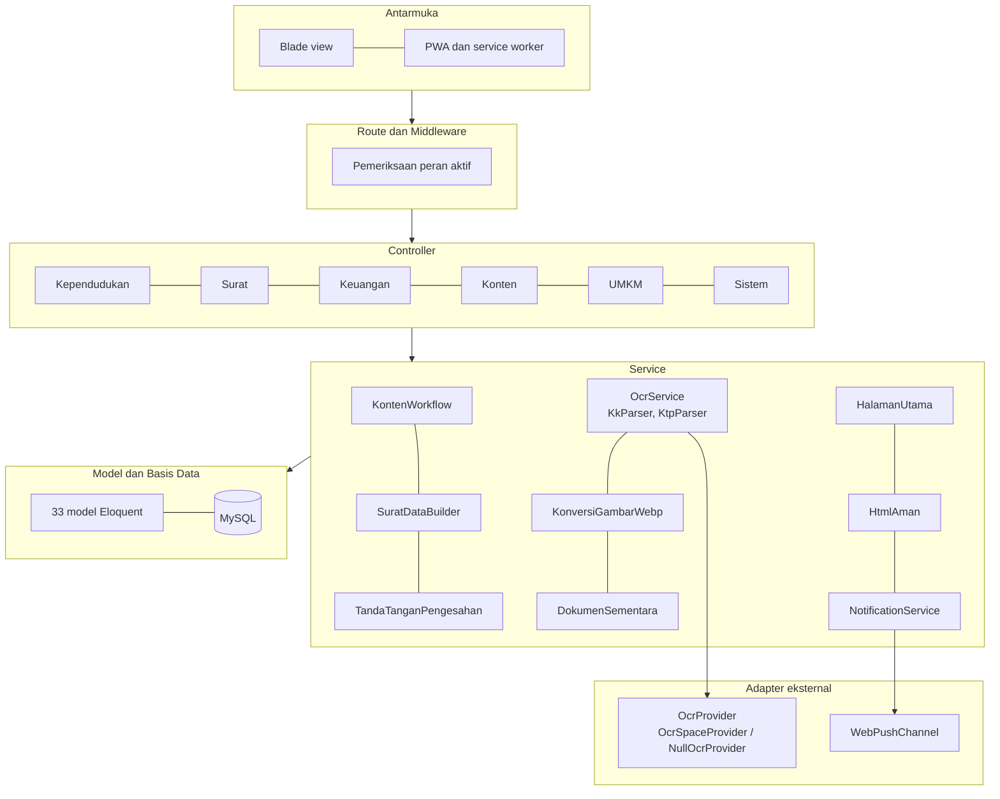

### 6.3 Penerapan

Image Docker dibangun bertahap (aset Vite, dependensi Composer, image aplikasi). Container aplikasi
menjalankan Nginx, PHP-FPM, queue worker, dan scheduler di bawah Supervisor; basis data berjalan di
container terpisah. Caddy di server menangani HTTPS. Skrip `scripts/deploy-update.sh` melakukan
backup basis data dan berkas, pembaruan kode, build, migrasi, pemeriksaan halaman, serta rollback
otomatis bila gagal, dan menyiapkan kunci Web Push serta konfigurasi OCR.

---

## 7. Desain Kelas dan Basis Data

### 7.1 Kelompok tabel

| Kelompok | Tabel |
|---|---|
| Akun dan otorisasi | `users`, `roles`, `permissions`, `model_has_roles`, `model_has_permissions`, `role_has_permissions`, `sessions`, `password_reset_tokens` |
| Wilayah dan kependudukan | `wilayah`, `master_rt`, `keluarga`, `penduduk`, `mutasi_warga`, `pejabat` |
| Surat | `pengajuan_surat`, `surat_pengajuans`, `layanan_surat` |
| Keuangan | `kategori_transaksi`, `rekening_bendahara`, `transaksi_keuangan`, `master_iuran`, `master_iuran_riwayat`, `iuran_pembayaran`, `tagihan`, `pembayaran_tagihan`, `setoran_pengaturan`, `setoran_rt`, `laporan_keuangan` |
| Informasi | `kategori_konten`, `berita`, `agenda`, `agenda_kehadiran`, `galeri_dokumentasi`, `pengumuman`, `fasilitas_umum` |
| UMKM | `kategori_umkm`, `umkm_usaha`, `kategori_produk`, `umkm_produk` |
| Sistem | `system_settings`, `activity_log`, `notifications`, `push_subscriptions`, `jobs`, `job_batches`, `failed_jobs`, `cache`, `cache_locks` |

### 7.2 Diagram relasi utama

> 🖼️ **DIAGRAM D-05: Entity Relationship Diagram (ERD) Utama**
> - **Jenis:** ERD notasi crow's foot
> - **Isi:** semua entitas dan relasi pada kode mermaid di bawah. Tampilkan nama tabel dan kunci
>   utama/asing (PK, FK) saja, tanpa seluruh kolom
> - **Tata letak:** empat kelompok berwarna latar lembut: Kependudukan dan Surat (kiri atas),
>   Keuangan (kanan atas), Informasi (kiri bawah), UMKM (kanan bawah); `master_rt` dan `users`
>   di tengah sebagai penghubung
> - **Penekanan:** `master_rt`, `keluarga`, dan `users` digambar lebih besar sebagai entitas pusat
> - **Catatan:** bila terlalu padat untuk satu halaman, pecah menjadi empat gambar D-05a
>   (Kependudukan dan Surat), D-05b (Keuangan), D-05c (Informasi), D-05d (UMKM), masing-masing tetap
>   menampilkan `master_rt`/`users` sebagai penghubung
> - **Sumber:** kode mermaid di bawah dan tabel 7.1
> - **Nama file:** `D-05-erd-utama.png` (atau `D-05a-...png` sampai `D-05d-...png`)

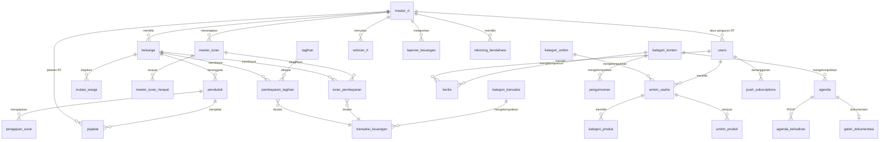

### 7.3 Catatan rancangan data

- Kolom `rt_id` pada tabel keuangan, konten, dan kategori menandai unit pemilik data. Nilai kosong
  berarti tingkat RW; unit DKM ditandai pada kolom unit.
- `pejabat` menyimpan masa jabatan (`is_active`, tanggal mulai dan selesai) sehingga riwayat
  kepengurusan tidak hilang dan surat atau laporan lama tetap memakai pejabat pada masanya.
- `master_iuran_riwayat` menyimpan perubahan nominal iuran, sehingga tagihan bulan lalu tidak ikut
  berubah ketika nominal diperbarui.
- Konten dan agenda memakai `slug` unik untuk alamat publik.

### 7.4 Class diagram desain

Class diagram desain menurunkan model domain (D-01) menjadi kelas-kelas implementasi. Model
(`App\Models`) memakai pola Active Record dari Eloquent: setiap kelas memetakan satu tabel pada
ERD, dan asosiasi diwujudkan sebagai method relasi. Perilaku bersama dipakai ulang lewat **trait**
(misalnya `PunyaSlug`, `PunyaCakupanRt`, `PunyaKategoriKonten`), logika lintas entitas ditempatkan
pada **kelas service**, dan layanan eksternal diakses melalui **interface** dengan beberapa
implementasi (polimorfisme), misalnya `OcrProvider`.

| Konsep domain (D-01) | Kelas desain | Catatan |
|---|---|---|
| RT | `MasterRt` | RW tidak dimodelkan sebagai kelas karena aplikasi melayani satu RW; nilai `rt_id` kosong berarti tingkat RW |
| Keluarga, Penduduk | `Keluarga`, `Penduduk` | `Keluarga::pemegangAkun()` menghubungkan ke `User` |
| Akun, Peran | `User` (+ trait `HasRoles` Spatie), `Role` | Peran aktif disimpan per sesi: `setActiveRole()`, `activeRole()` |
| Jabatan Pengurus | `Pejabat` | `setAktif()`, `pada()`, `namaKetuaRt()`, `namaKetuaRw()` |
| Pengajuan Perubahan Data | `MutasiWarga` | `timeline()`, `labelJenis()` |
| Pengajuan Surat, Dokumen Surat | `PengajuanSurat` + service `SuratDataBuilder` | Dokumen surat berupa snapshot data dan PDF, bukan kelas tersendiri |
| Unit Keuangan | atribut unit dan `rt_id` pada kelas keuangan | Generalisasi domain diwujudkan sebagai atribut pembeda, bukan subkelas |
| Iuran Bulanan | `MasterIuran`, `MasterIuranRiwayat`, `IuranPembayaran` | `nominalUntukBulan()`, `ubahNominal()` |
| Tagihan Insidental, Pembayaran | `Tagihan`, `PembayaranTagihan` | |
| Konten | `Berita`, `Agenda`, `Pengumuman` + trait | Generalisasi domain diwujudkan dengan trait bersama, bukan kelas induk |

> 🖼️ **DIAGRAM D-06a: Class Diagram Desain, Paket Kependudukan dan Surat**
> - **Jenis:** UML class diagram tingkat desain (atribut dengan tipe, operasi publik penting,
>   visibilitas `+`, stereotip «trait», «service», «interface»)
> - **Isi:** semua kelas, atribut, operasi, dan relasi pada kode mermaid di bawah
> - **Tata letak:** `User` dan `Keluarga` di tengah; `Penduduk` di bawah `Keluarga`; `Pejabat` dan
>   `MutasiWarga` di kanan; service `SuratDataBuilder` dan `TandaTanganPengesahan` di bawah dengan
>   garis dependensi putus-putus
> - **Penekanan:** komposisi `Keluarga` ◆ `Penduduk`; service berwarna hijau
> - **Sumber:** kode mermaid di bawah
> - **Nama file:** `D-06a-class-kependudukan-surat.png`

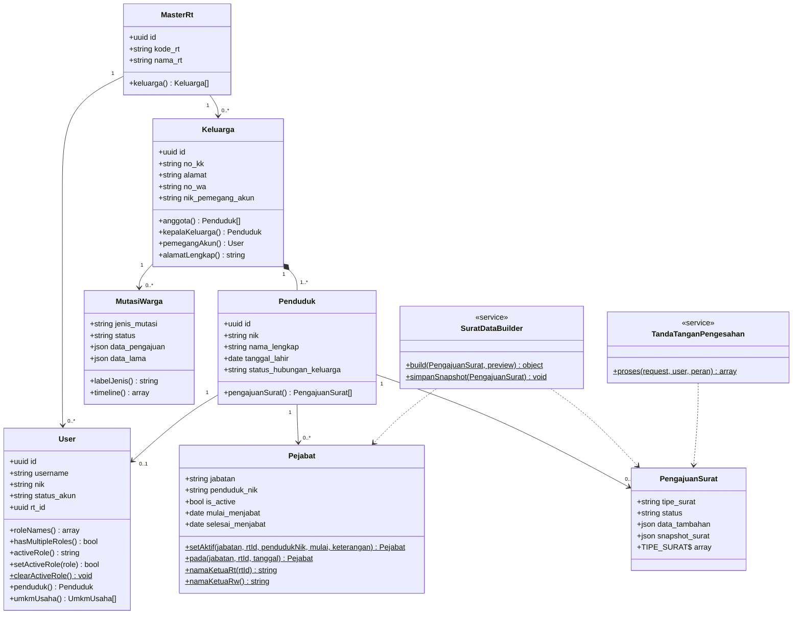

> 🖼️ **DIAGRAM D-06b: Class Diagram Desain, Paket Keuangan**
> - **Jenis:** UML class diagram tingkat desain
> - **Isi:** semua kelas, atribut, operasi, dan relasi pada kode mermaid di bawah
> - **Tata letak:** `TransaksiKeuangan` di tengah sebagai pusat; sumber pembayaran (`IuranPembayaran`,
>   `PembayaranTagihan`) di kiri; `KategoriTransaksi`, `RekeningBendahara` di kanan; `SetoranRt` dan
>   `LaporanKeuangan` di bawah
> - **Penekanan:** relasi `MasterIuran` ◆ `MasterIuranRiwayat` (riwayat nominal)
> - **Sumber:** kode mermaid di bawah
> - **Nama file:** `D-06b-class-keuangan.png`

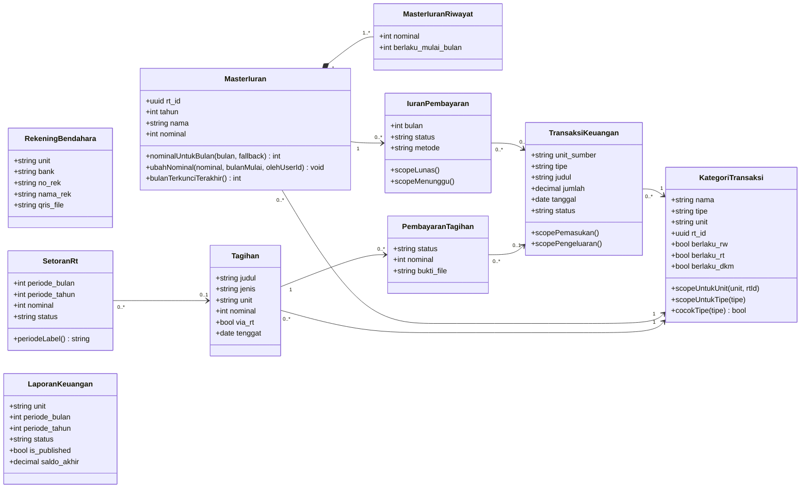

> 🖼️ **DIAGRAM D-06c: Class Diagram Desain, Paket Informasi dan UMKM**
> - **Jenis:** UML class diagram tingkat desain dengan trait
> - **Isi:** semua kelas, trait, atribut, operasi, dan relasi pada kode mermaid di bawah
> - **Tata letak:** tiga trait di atas; `Berita`, `Agenda`, `Pengumuman` di tengah dengan garis
>   «use» ke trait; `KategoriKonten` di kiri; `AgendaKehadiran`, `GaleriDokumentasi` di bawah
>   `Agenda`; paket UMKM (`KategoriUmkm`, `UmkmUsaha`, `KategoriProduk`, `UmkmProduk`) di kanan
> - **Penekanan:** trait digambar dengan stereotip «trait» dan garis realisasi putus-putus
> - **Sumber:** kode mermaid di bawah
> - **Nama file:** `D-06c-class-informasi-umkm.png`

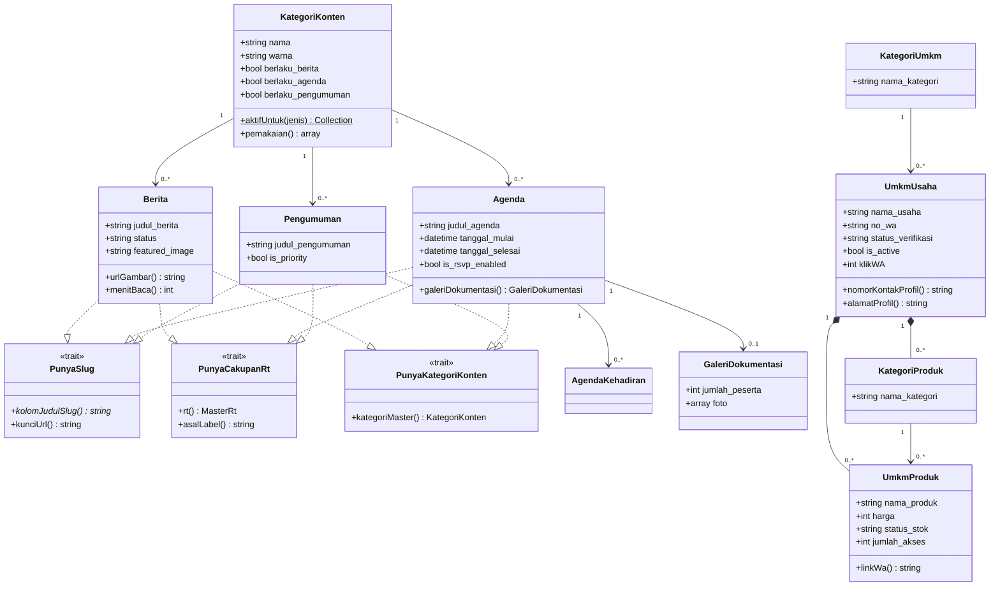

> 🖼️ **DIAGRAM D-06d: Class Diagram Desain, Service dan Adapter**
> - **Jenis:** UML class diagram tingkat desain (service, interface, implementasi)
> - **Isi:** semua kelas, interface, operasi, dan relasi pada kode mermaid di bawah
> - **Tata letak:** interface `OcrProvider` di tengah atas dengan dua implementasi di bawahnya;
>   `OcrService`, `KkParser`, `KtpParser` di kiri; service lain berjajar di bawah
> - **Penekanan:** realisasi interface (segitiga terbuka, garis putus-putus) sebagai contoh
>   polimorfisme; `KontenWorkflow` dan `NotificationService` diberi warna hijau
> - **Sumber:** kode mermaid di bawah
> - **Nama file:** `D-06d-class-service-adapter.png`

```mermaid
classDiagram
    direction TB
    class OcrProvider {
        <<interface>>
        +readText(absolutePath, mime) string
    }
    class OcrSpaceProvider {
        +readText(absolutePath, mime) string
    }
    class NullOcrProvider {
        +readText(absolutePath, mime) string
    }
    class OcrService {
        <<service>>
        +provider() OcrProvider
        +bacaKk(absolutePath, mime) array
        +bacaKtp(absolutePath, mime) array
    }
    class KkParser
    class KtpParser
    class KontenWorkflow {
        <<service>>
        +perluPersetujuan(jenis)$ bool
        +atributAjukan(jenis)$ array
        +sesudahDiajukan(konten, jenis)$ void
    }
    class NotificationService {
        <<service>>
        +isWebPushEnabled()$ bool
        +kirimKeUser(user, data)$ void
        +notifikasiSuratDiajukan(surat)$ void
        +notifikasiKontenPublish(jenis, judul, url, rtId)$ void
    }
    class KonversiGambarWebp {
        <<service>>
        +didukung()$ bool
        +simpanKeDisk(file, folder, disk, profil)$ string
        +simpanKePublik(file, folderPublik, prefix, profil)$ string
    }
    class DokumenSementara {
        <<service>>
        +simpanUpload(file, user)$ string
        +finalisasi(path, folderTujuan) string
        +bersihkanKedaluwarsa(umurJam)$ int
    }
    class HalamanUtama {
        <<service>>
        +bawaan()$ array
        +data()$ array
        +simpanData(data)$ void
    }
    class SystemSetting {
        +get(key, default)$ mixed
        +setMany(pairs)$ void
    }
    OcrSpaceProvider ..|> OcrProvider
    NullOcrProvider ..|> OcrProvider
    OcrService --> OcrProvider
    OcrService ..> KkParser
    OcrService ..> KtpParser
    KontenWorkflow ..> SystemSetting
    NotificationService ..> SystemSetting
    HalamanUtama ..> SystemSetting
    DokumenSementara ..> KonversiGambarWebp
```

---

## 8. Desain Alur Proses Utama

### 8.1 Pengajuan surat berjenjang

> 🖼️ **DIAGRAM D-07: Diagram Status Pengajuan Surat**
> - **Jenis:** UML state machine diagram
> - **Isi:** status Diajukan, Disetujui RT, Ditolak RT, Ditolak RW, Selesai beserta transisi dan
>   pelakunya, sesuai kode mermaid di bawah; tampilkan juga label yang dilihat warga di bawah tiap
>   status (Diajukan = "Menunggu RT", Disetujui RT = "Menunggu RW")
> - **Tata letak:** kiri ke kanan, jalur sukses di baris tengah, jalur ditolak di bawah
> - **Penekanan:** status menunggu kuning, Selesai hijau, Ditolak merah; catatan "snapshot data
>   disimpan" pada transisi menuju Selesai
> - **Sumber:** kode mermaid di bawah
> - **Nama file:** `D-07-status-surat.png`

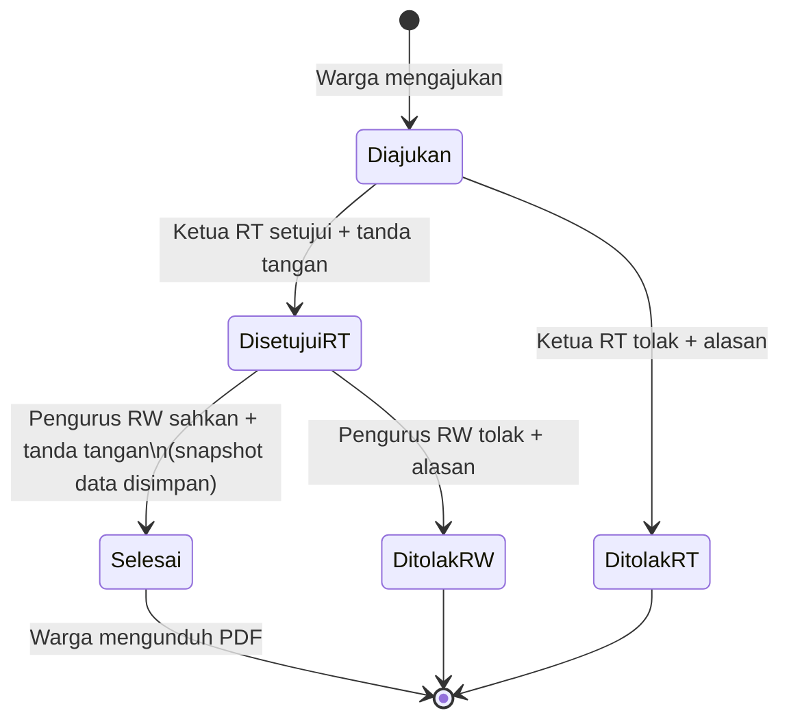

> 🖼️ **DIAGRAM D-08: Diagram Urutan Pengajuan sampai Pengesahan Surat**
> - **Jenis:** UML sequence diagram
> - **Isi:** partisipan Warga, Aplikasi, Ketua RT, Pengurus RW (Admin RW/Ketua RW), Basis Data;
>   urutan pesan sesuai kode mermaid di bawah
> - **Tata letak:** partisipan berjajar di atas dari kiri ke kanan; notifikasi digambar sebagai
>   panah putus-putus
> - **Penekanan:** langkah "simpan snapshot data surat" dan "buat PDF" diberi kotak catatan hijau
> - **Sumber:** kode mermaid di bawah
> - **Nama file:** `D-08-urutan-surat.png`

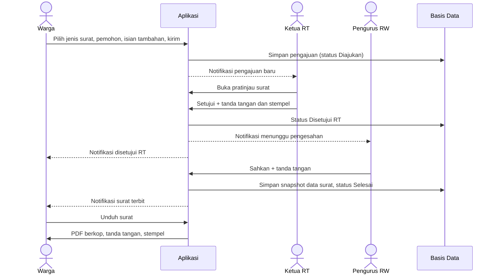

### 8.2 Perubahan data keluarga

> 🖼️ **DIAGRAM D-09: Alur Persetujuan Perubahan Data Keluarga**
> - **Jenis:** UML activity diagram dengan swimlane
> - **Isi:** lajur Warga, Ketua RT, Admin RW, Sistem; empat jenis pengajuan (tambah anggota, ubah
>   data KK, ubah data anggota, pindah pemegang akun); keputusan setujui/tolak di RT dan RW; hasil
>   akhir data diperbarui dan tercatat di log; khusus pindah pemegang akun: peran Warga pemegang
>   lama dicabut
> - **Tata letak:** lajur vertikal dari kiri ke kanan sesuai urutan pelaku
> - **Penekanan:** simpul keputusan berbentuk belah ketupat; jalur tolak merah
> - **Sumber:** kode mermaid di bawah dan FR-PDD-03, FR-PDD-04
> - **Nama file:** `D-09-alur-perubahan-data.png`

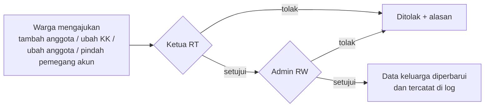

### 8.3 Iuran dan setoran

> 🖼️ **DIAGRAM D-10: Alur Iuran Warga dan Setoran RT ke RW**
> - **Jenis:** activity diagram dengan swimlane
> - **Isi:** lajur Warga, Bendahara RT, Bendahara RW; langkah: warga melihat tagihan (iuran bulanan
>   RT atau tagihan RW yang dikumpulkan lewat RT), unggah bukti, verifikasi bendahara RT
>   (valid/tidak valid), transaksi pemasukan RT, hitung setoran (nominal per KK), setor ke RW,
>   konfirmasi bendahara RW
> - **Tata letak:** lajur horizontal bertumpuk (atas Warga, tengah RT, bawah RW), alur kiri ke kanan
> - **Penekanan:** simbol uang/rekening pada langkah transaksi; jalur tidak valid kembali ke Warga
> - **Sumber:** kode mermaid di bawah dan FR-KEU-02 sampai FR-KEU-05
> - **Nama file:** `D-10-alur-iuran-setoran.png`

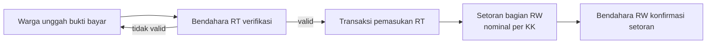

### 8.4 Laporan keuangan

> 🖼️ **DIAGRAM D-11: Alur Penyusunan dan Publikasi Laporan Keuangan**
> - **Jenis:** UML activity diagram (simpul awal/akhir, aksi, keputusan)
> - **Isi:** sesuai kode mermaid di bawah; tambahkan catatan bahwa unit RT, RW, dan DKM memiliki
>   laporan terpisah dan laporan baru terlihat warga setelah dipublikasikan
> - **Tata letak:** kiri ke kanan
> - **Penekanan:** dua tahap terpisah "disetujui" dan "dipublikasikan" diberi warna berbeda
> - **Sumber:** kode mermaid di bawah dan FR-KEU-07
> - **Nama file:** `D-11-alur-laporan-keuangan.png`

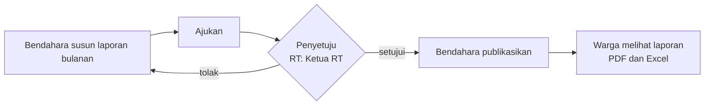

### 8.5 Konten dengan persetujuan yang dapat diatur

> 🖼️ **DIAGRAM D-12: Alur Konten dengan Persetujuan yang Dapat Diatur**
> - **Jenis:** UML activity diagram dengan catatan status objek Konten (Draft, Review, Revisi, Publish, Archive)
> - **Isi:** sesuai kode mermaid di bawah; tampilkan status Draft, Review, Revisi, Publish, Archive;
>   simpul keputusan "Persetujuan aktif untuk jenis ini?" terhubung ke kotak kecil "Pengaturan
>   Sistem (Admin Aplikasi): berita / agenda / pengumuman"
> - **Tata letak:** kiri ke kanan; jalur revisi melengkung kembali ke operator
> - **Penekanan:** simpul keputusan pengaturan diberi warna hijau sebagai keunikan rancangan
> - **Sumber:** kode mermaid di bawah dan FR-INF-02, FR-INF-03
> - **Nama file:** `D-12-alur-konten.png`

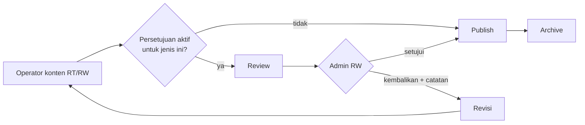

### 8.6 Pendaftaran UMKM

> 🖼️ **DIAGRAM D-13: Siklus Status Usaha UMKM**
> - **Jenis:** UML state machine diagram
> - **Isi:** status Pending, Approved, Rejected, Nonaktif dengan transisi sesuai kode mermaid di
>   bawah; pelaku: Warga (daftar, ajukan ulang) dan Admin RW (setujui, tolak, nonaktifkan, aktifkan)
> - **Tata letak:** melingkar; Approved di tengah kanan
> - **Penekanan:** jalur "perbaiki dan ajukan ulang" digambar tebal
> - **Sumber:** kode mermaid di bawah dan FR-UMK-02, FR-UMK-03
> - **Nama file:** `D-13-status-umkm.png`

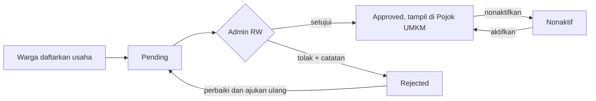

---

## 9. Desain Antarmuka

Antarmuka dibagi menjadi area publik dan area per peran. Tangkapan layar lengkap per peran tersedia
pada Manual Book (`docs/manual/`, 301 titik tangkapan layar). Untuk lampiran permohonan, gunakan
tangkapan layar berikut:

| No | Layar | Rujukan kode gambar di manual |
|---|---|---|
| 1 | Beranda publik dengan banner dan berita | `00-Umum-Publik-dan-Login.md` (UM) |
| 2 | Halaman masuk dan pilih peran | `00-Umum-Publik-dan-Login.md` (UM) |
| 3 | Dashboard warga (desktop dan HP) | `01-Warga.md` (W) |
| 4 | Formulir pengajuan surat | `01-Warga.md` (W) |
| 5 | Persetujuan surat dengan tanda tangan | `02-Ketua-RT.md` (KRT) |
| 6 | Contoh PDF surat yang sudah disahkan | `01-Warga.md` (W) |
| 7 | Tambah keluarga dengan pembacaan KK otomatis | `02-Ketua-RT.md` (KRT) |
| 8 | Iuran dan verifikasi pembayaran | `04-Op-Keuangan-RT.md` (OUT) |
| 9 | Laporan keuangan untuk warga | `01-Warga.md` (W) |
| 10 | Persetujuan konten | `05-Admin-RW.md` (ARW) |
| 11 | Pojok UMKM | `00-Umum-Publik-dan-Login.md` (UM) |
| 12 | Pengaturan Halaman Utama | `10-Admin-Aplikasi.md` (ADM) |

> 🖼️ **DIAGRAM D-14: Peta Navigasi Aplikasi per Peran**
> - **Jenis:** diagram navigasi (UML state machine navigasi layar: setiap layar sebagai status, menu sebagai transisi), boleh disajikan sebagai pohon
> - **Isi:** akar "Halaman Masuk → Pilih Peran"; cabang area publik (Beranda, Berita, Agenda,
>   Layanan Mandiri, Pojok UMKM); cabang per peran berisi menu utama sesuai urutan seragam
>   (Dashboard, Kependudukan/Profil Keluarga, Dokumen/Persetujuan, Keuangan, Pusat Informasi,
>   Pojok UMKM, Sistem). Isi menu per peran diambil dari peta menu di bab 1 setiap file
>   `docs/manual/01` sampai `10`
> - **Tata letak:** pohon horizontal kiri ke kanan; satu warna per kelompok menu
> - **Penekanan:** urutan menu yang seragam lintas peran
> - **Sumber:** paragraf ini dan peta menu di `docs/manual/`
> - **Nama file:** `D-14-peta-navigasi.png`

Prinsip desain antarmuka: menu disusun seragam untuk semua peran (Dashboard, data keluarga atau
kependudukan, dokumen atau persetujuan, keuangan, pusat informasi, UMKM, sistem); satu dialog
pemberitahuan untuk pesan sukses dan galat; status ditampilkan dengan lencana berwarna dan label
berbahasa sehari-hari (misalnya "Menunggu RT").

---

## 10. Keunikan dan Kebaruan Rancangan

1. **Akun per keluarga dengan pemegang yang dapat dipindah.** Satu akun mewakili satu KK, dapat
   mengajukan layanan untuk anggota mana pun, dan pemegangnya dapat dipindah melalui persetujuan
   RT tanpa kehilangan riwayat.
2. **Multi-peran dalam satu akun.** Seorang Ketua RT yang juga warga tidak perlu dua akun; ia
   memilih peran aktif dan menu menyesuaikan.
3. **Surat berjenjang dengan snapshot data.** Data surat dibekukan saat pengesahan sehingga dokumen
   resmi tidak berubah ketika data penduduk diperbarui, dan nama pejabat diambil dari kepengurusan
   yang aktif pada saat itu.
4. **Model keuangan tiga unit.** RT, RW, dan DKM memiliki pembukuan terpisah dalam satu sistem,
   dengan tagihan RW yang dapat dikumpulkan lewat RT, setoran per KK dari RT ke RW, dan publikasi
   laporan bertahap (disetujui, lalu dipublikasikan).
5. **Persetujuan konten yang dapat diatur per jenis.** Pengelola dapat memutuskan jenis konten
   mana yang perlu ditinjau tanpa mengubah kode.
6. **Pendataan berbantuan OCR dengan cadangan manual.** Foto KK dan KTP, termasuk dari kamera HP,
   diurai menjadi kolom formulir; aplikasi tetap dapat dipakai bila OCR tidak tersedia.
7. **Halaman Utama yang dikelola dari aplikasi.** Banner, footer, dan mitra diatur oleh Admin
   Aplikasi, termasuk memilih gambar dari galeri kegiatan.
8. **Penerapan tahan gagal.** Skrip pembaruan dengan backup, pemeriksaan kesehatan, dan rollback
   otomatis, sesuai untuk pengelola dengan sumber daya terbatas.

---

## 11. Pengujian dan Penjaminan Mutu

| Jenis | Keterangan |
|---|---|
| Pengujian otomatis | 53 file uji, 463 kasus uji lulus (2.410 asersi) pada basis data uji terpisah, mencakup alur surat, keuangan, konten, UMKM, Halaman Utama, konversi WebP, layanan mandiri, dan otorisasi |
| User Acceptance Testing | Skenario per modul pada `docs/Dokumen-UAT.md` (acceptance criteria AC-01 sampai AC-11) |
| Perbaikan defect | Rekap tiket bug dan perbaikannya pada `docs/bug_report_rekap.md` (tiket IR dan EV) |
| Pemeriksaan keamanan | Penutupan endpoint debug dan login instan, pembatasan wilayah, validasi status alur, pengamanan akses dokumen (Oktober 2026) |
| Pemeriksaan tampilan | Uji render halaman utama per peran dengan akun demo |

---

## 12. Riwayat Pengembangan

Riwayat berikut disusun dari catatan commit repositori Git, yang merekam tanggal dan isi setiap
perubahan.

| Periode | Tahap | Hasil utama |
|---|---|---|
| 25–26 Agustus 2026 | Inisiasi | Kerangka proyek, halaman awal, peran administrator, login |
| 3–9 September 2026 | Pengembangan modul inti | Arsitektur dan dashboard per peran; alur UMKM; persetujuan surat RT ke RW, PDF surat, tanda tangan digital; berita, agenda, pengumuman, galeri; profil keluarga; kalender kegiatan |
| 11–18 September 2026 | Keuangan dan sistem | Modul keuangan bertahap (persetujuan, laporan publik, tagihan, portal pembayaran, notifikasi, resi); pengaturan sistem, RBAC, log aktivitas, master RT; mutasi warga; dokumen teknis dan UAT; paket Docker dan skrip server |
| 3–22 Oktober 2026 | Pengamanan dan perbaikan | Aktivasi akun, penutupan endpoint berisiko, validasi alur mutasi, perbaikan tiket bug per modul, login dengan nomor WhatsApp |
| 24 Oktober 2026 | Penyempurnaan alur | Multi-peran dengan pilih peran, manajemen pejabat dan riwayat, pendataan keluarga oleh RT, pemilihan pemohon surat dari anggota keluarga |
| 11–13 November 2026 | Integrasi dan rilis | Keuangan RT/RW/DKM, statistik pimpinan, konten per RT, master kategori konten, Halaman Utama, agenda publik, alur UMKM lengkap, konversi WebP, data demo baru, manual book per peran |
| 13–15 November 2026 | Penerapan | Skrip pembaruan server dengan rollback, dukungan Web Push dan OCR di server |

> 🖼️ **DIAGRAM D-15: Garis Waktu Pengembangan**
> - **Jenis:** Gantt chart / timeline
> - **Isi:** tahap dan periode sesuai tabel di atas dan kode mermaid di bawah
> - **Tata letak:** sumbu waktu Agustus sampai November 2026 di atas, tahap sebagai batang horizontal
> - **Penekanan:** tonggak (milestone) "Rilis 13 November 2026"
> - **Sumber:** kode mermaid di bawah
> - **Nama file:** `D-15-garis-waktu.png`

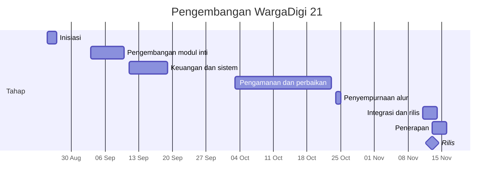

### 12.1 Kontributor kode tercatat di repositori

| Akun Git | Jumlah commit (perkiraan) | Area utama |
|---|---|---|
| elhakimfirdaus | 19 | Pengaturan sistem, RBAC, log, multi-peran, kepengurusan, integrasi modul, Halaman Utama, penerapan |
| hmzahiqball | 27 | Inisiasi proyek, modul warga, profil keluarga, mutasi warga, pengamanan akun |
| Za | 19 | Arsitektur awal, alur UMKM |
| Adirafi-22 | 14 | Persuratan, PDF, tanda tangan dan stempel |
| Nauval Khairiyan | 13 | Modul keuangan, tagihan, laporan |
| Rangga Tutorial | 11 | Berita, agenda, pengumuman, galeri |
| Hanif Muthiar Tsani | 1 | Sistem login |

Catatan: daftar pencipta pada bagian awal dokumen ditetapkan oleh tim. Tabel ini merekam jejak
teknis repositori sebagai bukti proses pembuatan.

---

## 13. Pernyataan Penggunaan Alat Bantu Kecerdasan Artifisial

Dalam pengembangan, tim menggunakan asisten pemrograman berbasis kecerdasan artifisial sebagai
alat bantu, antara lain untuk menulis dan merapikan kode, menyusun pengujian, menelusuri bug, dan
menyusun dokumentasi. Keputusan yang membentuk ciptaan dibuat oleh tim, antara lain:

- penetapan kebutuhan dan ruang lingkup berdasarkan kebutuhan pengurus dan warga RW 21;
- perancangan alur bisnis: persetujuan surat berjenjang, model keuangan tiga unit, alur
  persetujuan konten yang dapat diatur, aturan UMKM (siapa menyetujui, pengajuan ulang, banyak usaha
  per warga), struktur dan urutan menu, serta pengaturan Halaman Utama;
- pemilihan teknologi, arsitektur, dan cara penerapan;
- peninjauan, pengujian, dan penerimaan setiap perubahan sebelum digabung ke kode utama;
- penyusunan data demo dan manual book per peran.

Alat bantu tidak menentukan kebutuhan maupun desain secara mandiri; setiap keluaran ditinjau dan
diputuskan oleh tim.

---

## 14. Lampiran

| No | Lampiran | Lokasi |
|---|---|---|
| 1 | Dokumen Teknis Pengembangan | `docs/Dokumen-Teknis-Pengembangan.md` |
| 2 | Dokumen UAT | `docs/Dokumen-UAT.md` |
| 3 | Peta alur web | `docs/Peta-Alur-Web.md` |
| 4 | Manual book per peran (11 file) dan daftar akun demo | `docs/manual/` |
| 5 | Panduan penerapan | `docs/Deploy-Server-Caddy.md`, `docs/Panduan-Deployment.md` |
| 6 | Rekap bug dan perbaikan | `docs/bug_report_rekap.md` |
| 7 | Contoh kode inti (untuk lampiran kode program) | `app/Services/KontenWorkflow.php`, `app/Services/SuratDataBuilder.php`, `app/Services/TandaTanganPengesahan.php`, `app/Services/Ocr/OcrService.php`, `app/Services/KonversiGambarWebp.php`, `app/Http/Controllers/RoleSwitchController.php` |
| 8 | Contoh keluaran: PDF surat dan PDF laporan keuangan | dihasilkan dari akun demo |
| 9 | Riwayat commit lengkap | `git log --date=short --format="%ad %an %s"` |

### Daftar Diagram

| Kode | Judul | Bagian | Jenis | Nama file |
|---|---|---|---|---|
| D-01 | Model Domain WargaDigi 21 (Class Diagram Konseptual) | 2.4 | UML class diagram konseptual | `D-01-model-domain.png` |
| D-02 | Diagram Use Case WargaDigi 21 | 5.1 | UML use case | `D-02-use-case.png` |
| D-03 | Arsitektur Penerapan (Deployment) | 6.1 | UML deployment diagram | `D-03-arsitektur-penerapan.png` |
| D-04 | Arsitektur Lapisan dan Komponen Aplikasi | 6.2 | UML component diagram | `D-04-arsitektur-lapisan.png` |
| D-05 | Entity Relationship Diagram (ERD) Utama | 7.2 | ERD | `D-05-erd-utama.png` |
| D-06a | Class Diagram Desain, Paket Kependudukan dan Surat | 7.4 | UML class diagram desain | `D-06a-class-kependudukan-surat.png` |
| D-06b | Class Diagram Desain, Paket Keuangan | 7.4 | UML class diagram desain | `D-06b-class-keuangan.png` |
| D-06c | Class Diagram Desain, Paket Informasi dan UMKM | 7.4 | UML class diagram desain | `D-06c-class-informasi-umkm.png` |
| D-06d | Class Diagram Desain, Service dan Adapter | 7.4 | UML class diagram desain | `D-06d-class-service-adapter.png` |
| D-07 | Diagram Status Pengajuan Surat | 8.1 | State machine | `D-07-status-surat.png` |
| D-08 | Diagram Urutan Pengajuan sampai Pengesahan Surat | 8.1 | Sequence | `D-08-urutan-surat.png` |
| D-09 | Alur Persetujuan Perubahan Data Keluarga | 8.2 | Activity swimlane | `D-09-alur-perubahan-data.png` |
| D-10 | Alur Iuran Warga dan Setoran RT ke RW | 8.3 | Activity swimlane | `D-10-alur-iuran-setoran.png` |
| D-11 | Alur Penyusunan dan Publikasi Laporan Keuangan | 8.4 | UML activity | `D-11-alur-laporan-keuangan.png` |
| D-12 | Alur Konten dengan Persetujuan yang Dapat Diatur | 8.5 | UML activity | `D-12-alur-konten.png` |
| D-13 | Siklus Status Usaha UMKM | 8.6 | State machine | `D-13-status-umkm.png` |
| D-14 | Peta Navigasi Aplikasi per Peran | 9 | Navigasi layar | `D-14-peta-navigasi.png` |
| D-15 | Garis Waktu Pengembangan | 12 | Gantt | `D-15-garis-waktu.png` |

[ISI: Untuk permohonan ke DJKI, siapkan juga surat pernyataan kepemilikan, surat pengalihan hak
bila pemegang hak adalah institusi, dan contoh ciptaan sesuai ketentuan pada laman e-hakcipta.]
